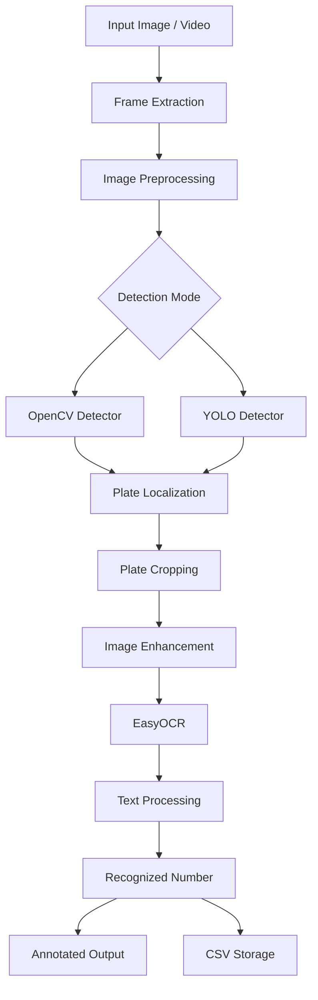
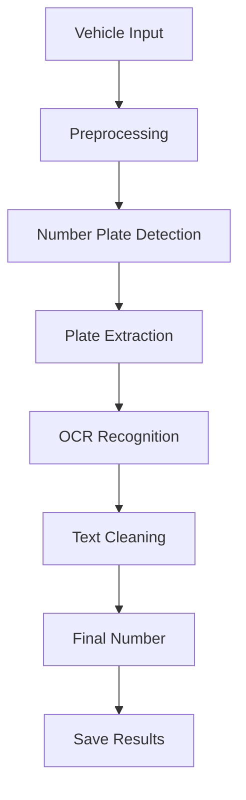

# 🚘 Automatic Number Plate Recognition (ANPR)

  <h2>ANPR - Vehicle Number Plate Recognition System</h2>
  
Intelligent Vehicle Detection using Computer Vision and OCR

## 📌 About Project

Automatic Number Plate Recognition (ANPR)
is a Computer Vision project designed to detect
vehicle number plates and extract registration
numbers automatically.

## 🎯 Project Objectives

- Detect vehicle number plates.
- Extract text using OCR.
- Process vehicle images and videos.
- Generate annotated output.
- Save recognition results in CSV format.

## 🛠️ Technologies Used

- Python
- OpenCV
- YOLO
- EasyOCR
- NumPy
- PyTorch

## ⚙️ Two Detection Approaches

1. OpenCV + EasyOCR
2. YOLO + OpenCV + EasyOCR

## 🔄 Project Workflow

Input Image / Video
       ↓
Frame Extraction
       ↓
Image Preprocessing
       ↓
Number Plate Detection
       ↓
Plate Cropping
       ↓
OCR Text Recognition
       ↓
Final Number Plate Output

## 👨‍💻 Developed By

**Rajnish Kumar**

B.E. Information Technology

GitHub: https://github.com/rajnish-dev1

## 🚀 Future Scope

- Real-time vehicle detection
- Indian number plate validation
- Vehicle tracking
- Database integration
- Smart parking management

## 📄 License

MIT License
---

## 🏗️ System Architecture

The ANPR system follows a modular
computer vision architecture.

## 🔄 Processing Pipeline

## 📂 Project Structure

See the complete project structure
in the repository folders.

## 📚 Documentation

- [System Architecture](assets/architecture.md)
- [Processing Pipeline](assets/pipeline.md)
- [Dataset Guide](dataset/README.md)
- [YOLO Model Guide](models/README.md)
- [Contribution Guidelines](CONTRIBUTING.md)

## 👨‍💻 Author

**Rajnish Kumar**

B.E. Information Technology

[GitHub Profile](https://github.com/rajnish-dev1)
